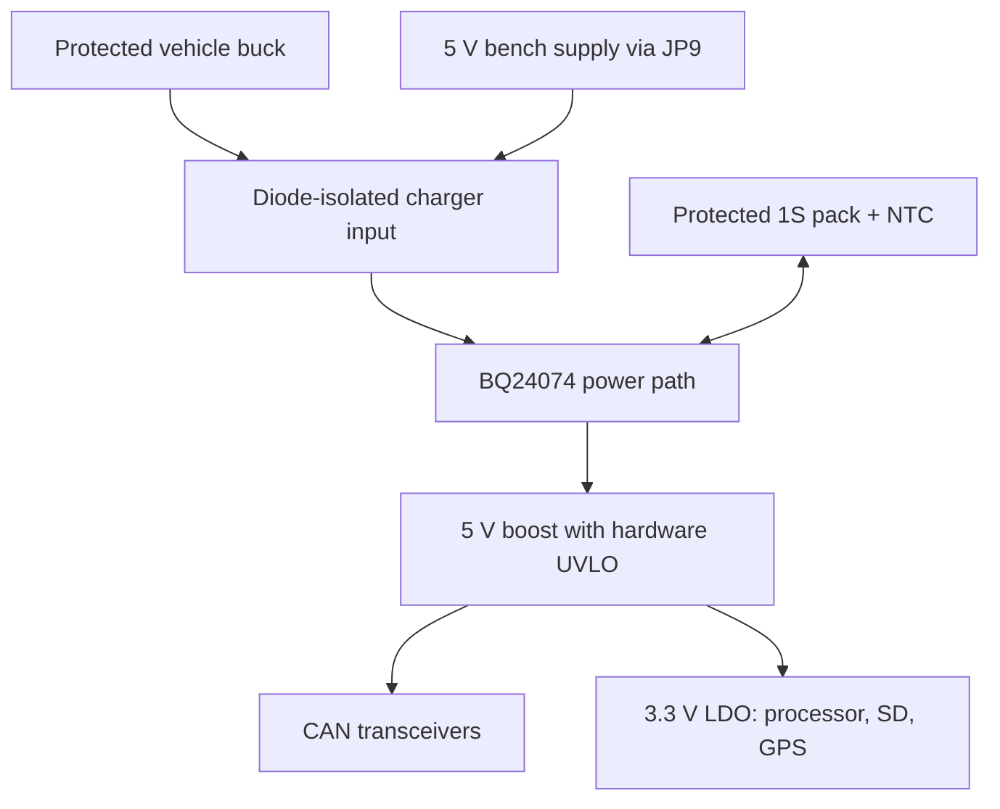

# QuadCAN-C5: 4-channel CAN-FD logger

**Rev 1.1 battery prototype — engineering draft, not released for manufacture.**
See [the revision notes and verification limits](docs/BATTERY_REVISION.md). Firmware for this revision is incompatible with the rev 1.0 pin map.


A custom, from-scratch take on the MrDIY DuoCAN idea, grown into a set-and-forget vehicle logger:

* **4 independent CAN / CAN-FD channels.** The ESP32-C5 has two native CAN-FD controllers, plus 2 × MCP2518FD.
* **One harness connector, swappable vehicle cables:** OBD-II (gateway + power) or heavy-duty
  **J1939** Deutsch 9-pin. Cable-ID pins tell the firmware which cable is attached. See [docs/CABLES.md](docs/CABLES.md).
* **Onboard microSD logging** with a protected 1S Li-ion backup power path and a 30-second crank grace period.
  A **real-time clock** with coin-cell backup timestamps every file.
* **Wi-Fi 6 dual-band + Wi-Fi Aware** (ESP32-C5) for a phone link, plus an optional soft-AP fallback.
* **Optional u-blox NEO-M9N GPS** at 20 Hz (25 Hz max) with an active-antenna u.FL. Leave it
  unpopulated to rely on the phone's location.
* **LTE add-on header** (UART + power key + VIN) for a Cat-1 module board.
* **9–36 V input** for 12 V cars and 24 V trucks.
* **Key-off sleep** (rev 1.1 current not yet measured): wakes on traffic on any of the four buses, an ignition wire, or the
  battery voltage rising when the engine starts. See [docs/LOW_POWER.md](docs/LOW_POWER.md).
* **Bus-safe by construction:** transceivers boot in standby, firmware opens channels listen-only,
  and a channel can't transmit at all unless its **TX_EN** jumper is fitted.

The 140 × 85 mm, four-layer prototype retains four high-speed CAN channels. It does **not** support the Jetta's 100 kbit/s fault-tolerant comfort bus without a different physical-layer design.



The LTE header's VIN feed is not battery-backed. JP9 defaults open; USB data remains available. A battery pack and its mounting are external to the PCB BOM.


## Repository layout

| Path | What |
|---|---|
| `gen/design.py` | **Single source of truth**: every part, footprint, MPN and pin-to-net connection |
| `gen/gen_lib.py` | Custom symbols + the ESP32-C5-WROOM-1 footprint (from Espressif's land pattern) |
| `gen/gen_sch.py` | Generates the KiCad schematic from `design.py` |
| `gen/gen_pcb.py` | Board outline, 4-layer stack, placement, ground pours |
| `gen/route.py`, `route_core.c` | Autorouter: direction-aware A* (C core) + rip-up-and-reroute; 45° tracks, In1.Cu kept as solid GND |
| `render/` | Bare-board and 3D renders (`render/render.sh` → `docs/renders/`) |
| `gen/build.sh` | Runs the whole chain: schematic → netlist check → board → route → DRC → fab files |
| `kicad/` | Generated KiCad 9 project (open `quadcan-c5.kicad_pro`) |
| `fab/` | Gerbers (zip), drill, BOM, pick-and-place, schematic PDF, DRC report |
| `firmware/` | ESP-IDF v6 firmware + `.qcl` log converter |
| `enclosure/` | OpenSCAD two-part case + STLs |
| `docs/CABLES.md` | Harness pinout, OBD-II and J1939 cable builds, jumper rules |

## Key design decisions

| Choice | Why |
|---|---|
| ESP32-C5-WROOM-1-N8R8 | Two native CAN-FD controllers, 5 GHz Wi-Fi 6, Wi-Fi Aware support in ESP-IDF, 8 MB PSRAM for a deep log buffer |
| MCP2518FD for CAN3/4 | CAN-FD, 2 KB message RAM (20-frame RX FIFO with hardware timestamps), shares SPI with the SD card |
| TCAN1044AV-Q1 | CAN-FD rated, separate 3.3 V I/O supply, ~15 µA standby with bus wake-up. NXP TJA1044GT/3 is a drop-in alternative. |
| TPS54360 60 V buck | Wide-input converter behind TVS/fuse protection; vehicle transient tolerance requires testing. |
| BQ24074 + protected 1S pack + 5 V boost | Backs the CAN and logic rails through cranking; 30-second firmware grace |
| TCA9535 expander | Frees ESP32 pins; resets to inputs, so every transceiver's STB line floats high (standby) until firmware decides otherwise |
| Molex Micro-Fit 2×7 | Locking, vibration-rated, cheap to crimp; one plug for any vehicle cable |

## Prototype status

The design is not released for ordering. See [fab/STATUS.md](fab/STATUS.md) for measured automated-check results and [docs/BATTERY_REVISION.md](docs/BATTERY_REVISION.md) for unresolved hardware and firmware gates. Fabrication data, if generated, is for engineering review only. BOM passive MPNs, pack selection and assembly rotations still need procurement review.

## Rebuilding

```sh
sudo apt install kicad   # KiCad 9.x
pip install kiutils numpy scipy pillow   # plus gcc for the router core
SKIP_ROUTE=1 bash hardware/quadcan-c5/gen/build.sh
```

The checked route cache is tied to a SHA-256 of the placement geometry. A geometry change invalidates it; omit `SKIP_ROUTE` for a new routing run, then review its new DRC results. The fine-grid finishing pass operates only on signal/ground escapes.
