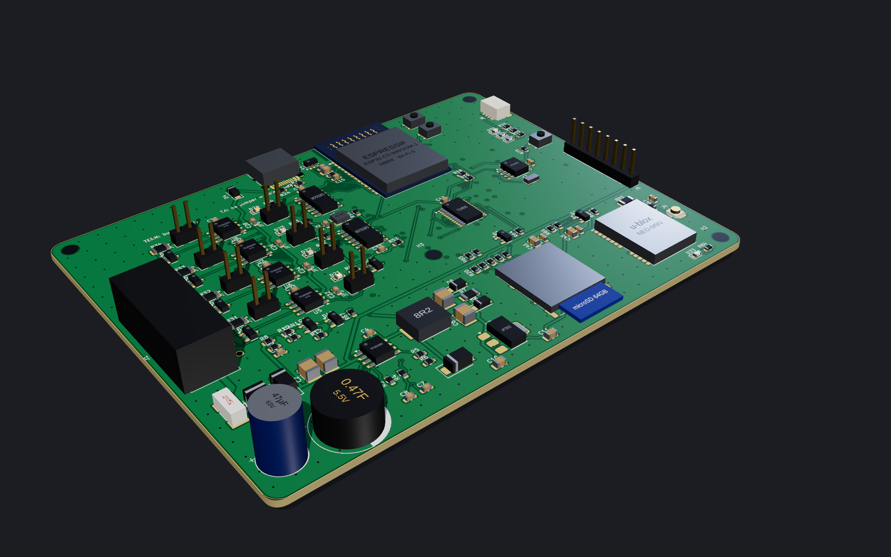
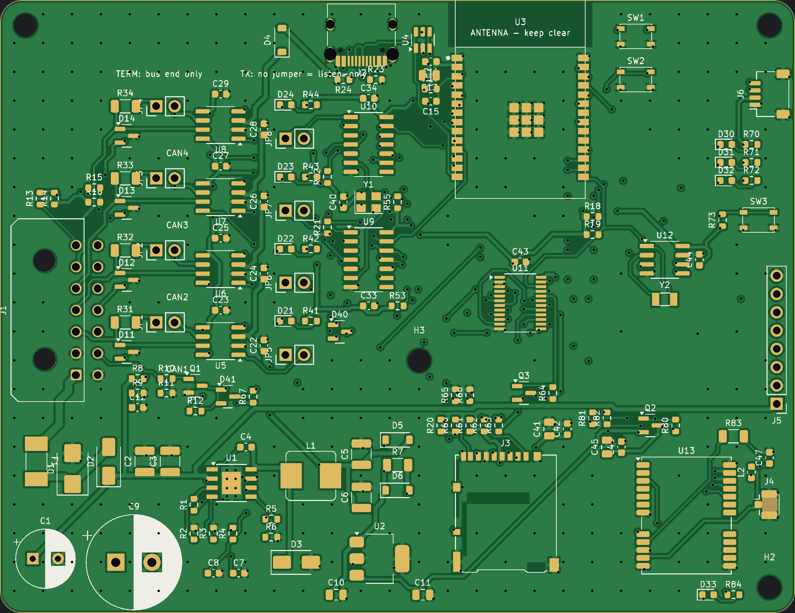

# QuadCAN-C5: 4-channel CAN-FD logger

A custom, from-scratch take on the MrDIY DuoCAN idea, grown into a set-and-forget vehicle logger:

* **4 independent CAN / CAN-FD channels.** The ESP32-C5 has two native CAN-FD controllers, plus 2 × MCP2518FD.
* **One harness connector, swappable vehicle cables:** OBD-II (gateway + power) or heavy-duty
  **J1939** Deutsch 9-pin. Cable-ID pins tell the firmware which cable is attached. See [docs/CABLES.md](docs/CABLES.md).
* **Onboard microSD logging** with supercap hold-up, so files close cleanly when power is pulled.
  A **real-time clock** with coin-cell backup timestamps every file.
* **Wi-Fi 6 dual-band + Wi-Fi Aware** (ESP32-C5) for a phone link, plus an optional soft-AP fallback.
* **Optional u-blox NEO-M9N GPS** at 20 Hz (25 Hz max) with an active-antenna u.FL. Leave it
  unpopulated to rely on the phone's location.
* **LTE add-on header** (UART + power key + VIN) for a Cat-1 module board.
* **9–36 V input** for 12 V cars and 24 V trucks.
* **Key-off sleep** (est. ~0.5 mA): wakes on traffic on any of the four buses, an ignition wire, or the
  battery voltage rising when the engine starts. See [docs/LOW_POWER.md](docs/LOW_POWER.md).
* **Bus-safe by construction:** transceivers boot in standby, firmware opens channels listen-only,
  and a channel can't transmit at all unless its **TX_EN** jumper is fitted.

```
                 ┌──────────── QuadCAN-C5 (110 x 85 mm, 4-layer) ────────────┐
 Micro-Fit 2x7   │ ESD ─ TCAN1044AV ─ TX_EN ─ ESP32-C5 CAN-FD 0   (CAN1)     │  USB-C (flash/console)
 VIN GND IGN ────│ ESD ─ TCAN1044AV ─ TX_EN ─ ESP32-C5 CAN-FD 1   (CAN2)     │
 CAN1..4 H/L     │ ESD ─ TCAN1044AV ─ TX_EN ─ MCP2518FD ─┐ SPI    (CAN3)     │  Wi-Fi 6 / Wi-Fi Aware
 CABLE_ID0/1     │ ESD ─ TCAN1044AV ─ TX_EN ─ MCP2518FD ─┤        (CAN4)     │
                 │                         microSD ───────┘                   │  NEO-M9N GPS ─ u.FL
                 │ fuse ─ TVS ─ diode ─ TPS54360 5V ─ supercap ─ 3.3V LDO     │  LTE header, Qwiic
                 │ TCA9535 IO expander (STB, LEDs, cable ID, IGN, GPS power)  │  PCF8523 RTC + CR1220
                 └────────────────────────────────────────────────────────────┘
```

## Repository layout

| Path | What |
|---|---|
| `gen/design.py` | **Single source of truth**: every part, footprint, MPN and pin-to-net connection |
| `gen/gen_lib.py` | Custom symbols + the ESP32-C5-WROOM-1 footprint (from Espressif's land pattern) |
| `gen/gen_sch.py` | Generates the KiCad schematic from `design.py` |
| `gen/gen_pcb.py` | Board outline, 4-layer stack, placement, ground pours |
| `gen/route.py`, `route_core.c` | Autorouter: direction-aware A* (C core) + rip-up-and-reroute; 45° tracks, In1.Cu kept as solid GND |
| `render/` | Bare-board and 3D renders (`render/render.sh` → `docs/renders/`) |
| `gen/build.sh` | Runs the whole chain: schematic → netlist check → board → route → DRC → fab files |
| `kicad/` | Generated KiCad 7 project (open `quadcan-c5.kicad_pro`) |
| `fab/` | Gerbers (zip), drill, BOM, pick-and-place, schematic PDF, DRC report |
| `firmware/` | ESP-IDF v6 firmware + `.qcl` log converter |
| `enclosure/` | OpenSCAD two-part case + STLs |
| `docs/CABLES.md` | Harness pinout, OBD-II and J1939 cable builds, jumper rules |

## Key design decisions

| Choice | Why |
|---|---|
| ESP32-C5-WROOM-1-N8R8 | Two native CAN-FD controllers, 5 GHz Wi-Fi 6, Wi-Fi Aware support in ESP-IDF, 8 MB PSRAM for a deep log buffer |
| MCP2518FD for CAN3/4 | CAN-FD, 2 KB message RAM (20-frame RX FIFO with hardware timestamps), shares SPI with the SD card |
| TCAN1044AV-Q1 | CAN-FD rated, separate 3.3 V I/O supply, ~15 µA standby with bus wake-up. NXP TJA1044GT/3 is a drop-in alternative. |
| TPS54360 60 V buck | Survives 24 V truck systems and load-dump transients behind the SMBJ36A TVS. Values are TI's datasheet 5 V reference design. |
| 0.47 F supercap on the logic rail | ~4 s to flush and close the log after the plug is pulled |
| TCA9535 expander | Frees ESP32 pins; resets to inputs, so every transceiver's STB line floats high (standby) until firmware decides otherwise |
| Molex Micro-Fit 2×7 | Locking, vibration-rated, cheap to crimp; one plug for any vehicle cable |

## Ordering the board

> **Current status:** fully routed, KiCad DRC shows no copper errors, never built. Details in
> [fab/STATUS.md](fab/STATUS.md).




1. Upload `fab/quadcan-c5-gerbers.zip` to JLCPCB/PCBWay: **4 layers, 1.6 mm, 1 oz outer / 0.5 oz inner**, any colour.
   Minimum features used: 0.15 mm clearance, 0.2 mm track, 0.3/0.6 mm vias.
2. For assembly, use `fab/quadcan-c5-bom.csv` + `fab/quadcan-c5-cpl.csv`. Through-hole parts
   (harness connector, headers, supercap, bulk cap, CR1220 holder) are marked *hand-solder*.
   Match MPNs to the assembler's stock (LCSC part numbers aren't filled in yet).
3. Leave **U13 / J4 / bias-T** unpopulated if you'll use the phone's GPS.

## Before you order: review checklist

The board was generated and checked automatically (netlist match, DRC), but a person hasn't reviewed it.
Read [docs/REVIEW.md](docs/REVIEW.md) first. It lists what to check by eye in KiCad.

## Rebuilding

```sh
sudo apt install kicad   # KiCad 7.x
pip install kiutils numpy scipy pillow   # plus gcc for the router core
hardware/quadcan-c5/gen/build.sh
```
